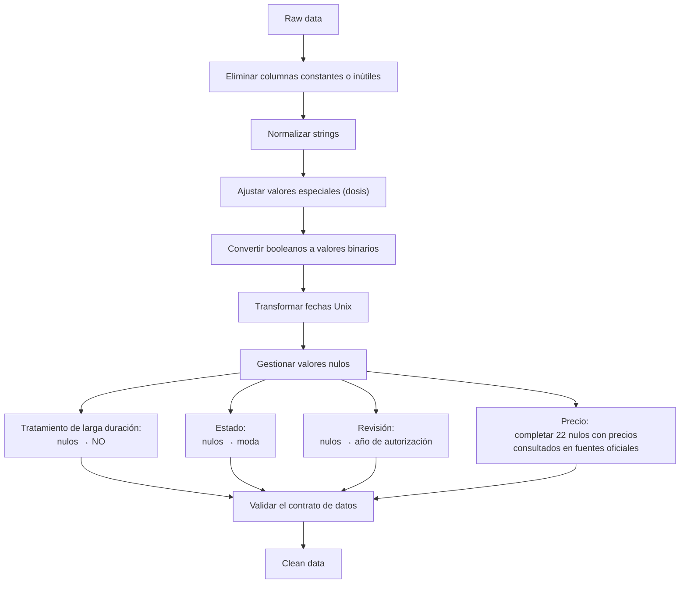

# Preprocesado

#### Gonzalo Carrasco, Santiago Lillo, Rafael Sánchez

Datos originales: `src/data/HU-3.csv`. Datos preprocesados: `src/data/HU4_EDA.xlsx`. 70 medicamentos contra la migraña.

---
Este documento explica todo el pipeline de preprocesado de los datos.

## Esquema




## Columnas eliminadas

Inicialmente, el dataset presenta 32 columnas. Eliminamos:

- `url_html_ficha_tecnica`: una vez que obtenemos la información necesaria de la ficha técnica (en historias de usuarios anteriores), no aporta información útil. Lo mismo para `url_foto_materiales`, que podría ser útil si quisiéramos entrenar un modelo con estas imágenes.

- `nregistro`, `cn`, y `Código Nacional` son identificadores. Los eliminamos porque utilizamos `nombre` como columna identificadora.

- `Precio de referencia`: todos los valores no nulos de estas columnas son los mismos que en `Precio venta al público con IVA`. Además, existe un valor no nulo de `Precio venta al público con IVA` no presente en `Precio de referencia`. Por tanto, eliminamos al columna `Precio de referencia` y mantenemos `Precio venta al público con IVA`.

- `requiere_receta`: todos los medicamentos requieren receta. Es una columna con un valor constante; el modelo no aprende nada de ella.

- `triangulo_negro`: ningún medicamento está marcado con el triángulo negro invertido, símbolo que identifica medicamentos sujetos a seguimiento adicional de seguridad. 

- `medicamento_huerfano`: ninguno lo es. Los medicamento huérfanos tratan una enfermedades raras. Se llaman así porque están _huérfanos_ de inversión.

- `biosimilar`: ninguno es biosimilar. La mayoría de los medicamentos biosimilares son de uso exclusivo en hospitales. Por tanto, estamos ante medicamentos distribuibles en farmacias tradicionales.

- `num_registros_atc`: todos los medicamentos analizados tienen valor  constante 3.

- `Especial control médico`: había únicamente valores NO y nulos; no había medicamentos marcados con SI. Se ha supuesto que los nulos no necesitan especial control médico (si lo necesitaran deberían estar marcados), dando lugar a una columna constante.

## Normalizar strings

En primer lugar se aplicó un `.str.strip()` a todas las columnas cuyo tipo sea string, para eliminar los esppacios al principio y al final de cada palabra.

Después, se han simplificado algunos valores de las variables, como 

```
"SOLUCIÓN/SUSPENSIÓN ORAL"           --> "SOLUCIÓN"
"COMPRIMIDO BUCODISPERSABLE/LIOTAB"  --> "COMPRIMIDO BUCODISPERSABLE"
"VÍA INTRAMUSCULAR ,VÍA INTRAVENOSA" --> "VÍA INTRAMUSCULAR"
```

Para la columna `dosis`, los strings eran de la forma `12,5 mg `. El proceso que se siguió con 

```
df["dosis"] = df["dosis"].str.strip().str.split().str[0].str.replace(",", ".").astype(float)
df = df.rename(columns={"dosis": "dosis (mg)"})
```

es el siguiente:

1. `12,5 mg ` &rarr; `12,5 mg`
2. `12,5 mg` &rarr;  `['12,5', 'mg']`
3. `['12,5', 'mg']`  &rarr; `'12,5'`
4. `'12,5'` &rarr; `'12.5'`
5. `'12.5'` &rarr; `12.5`
6. Renombrar la columna `dosis` a `dosis (mg)` para no perder información.

En realidad, la interpretación de los miligramos depende de la forma farmacéutica simplificada:

- Comprimidos: mg en cada pastilla

- Solución/Producto uso natal: mg/ml

- Inyectable: mg por vial

No obstante, hay cuatro medicamentos con los que no podemos seguir esos 5 pasos:

| Medicamento | Dosis |
|---|---:|
| CAFERGOT 1 mg/100 mg COMPRIMIDOS | 1 mg ergotamina+100 mg cafeina |
| METOPROLOL KRKA RETARD 95 MG COMPRIMIDOS DE LIBERACION PROLONGADA EFG | 95 mg (100 mg de metotrolol tartrato |
| PRIMPERAN 1mg /ml SOLUCION ORAL | 100 mg metoclopramida/100 ml |
| PRIMPERAN 10 mg /2 ml SOLUCION INYECTABLE | 10 mg metoclopramida/2 ml |

Se han realizado los siguientes cambios:

- Para el primer medicamento, se ha considerado una dosis de 101 mg. Aunque 101mg de ergotamina es una sobredosis, es una cantidad normal cafeína. Pese a que el medicamento tiene dos principios activos, el dataset está considerando `CAFEINA, ERGOTAMINA TARTRATO` como un único string, así que no se han cambiado los principios activos.

- Para el segundo medicamento, se ha considerado una dosis de 95mg, ya que esta equivale a 100 mg de metrolol tartrato. Los 100mg es un valor de referencia para hacer comparativas.

- Para el tercer medicamento, se ha tomado como referencia la dosis que aparece en el nombre `1mg/ml`, que corresponde con 100mg/100ml de la columna `dosis`.

- Para el último medicamento, se ha simplificado a 5mg.

Cabe destacar que tres de los cuatro medicamentos citados tienen fecha de autorización previa a 1970. Un menor cuidado a la hora de introducir los datos podría explicar el formato de tales valores.

## Booleanos a enteros

Las columnas `Tratamiento de larga duración` y `generico` se han transformado a valores 0/1. Si los valores son `True` o `False`, basta con `.astype(int)`. Si los valores son `Sí`/`No`, hay que hacer previamente `.replace("NO", 0)` y `.replace("SI", 1)`.

## Fechas

Los datos provenían inicialmente en formato Unix, es decir, milisegundos desde el 1 de enero de 1970 a las 00:00:00 UTC. Primero hacemos el cambio a un formato de fecha que `pandas` reconozca, y después nos quedamos solo con el año. El modelo requiere números como input, por lo que no distingue qué es un mes o un día. Debido a la variedad en las fechas, se ha considerado que el año es un número suficiente, eliminando así los meses, días, horas, minutos, y segundos. No obstante, si las fechas estuvieran concentradas en pocos años, sí consideraríamos los meses.

```
df["estado_aut"] = pd.to_datetime(df["estado_aut"], unit="ms")
df["estado_aut"] = df["estado_aut"].dt.year
```

## Nulos

- `Tratamiento de larga duración`. Los nulos se han sustituido por `NO`. Se ha supuesto que, si un medicamento necesitara un tratamiento de larga duración, debería estar indicado.

- `Estado`. Los nulos se han sustituido por la moda con `df["Estado"].mode()`, debido a que es una variable categórica.

- `estado_rev`. Los nulos se han sustituido por su fecha de autorización correspondiente. Si no tienen fecha de revisión disponible, se ha supuesto que aún no se han revisado.

- `Precio venta al público con IVA`. Originalmente teníamos 22 nulos de 70 medicamentos. Como nuestro dataset es pequeño, hemos podido buscar en fuentes oficiales online los precios de los medicamentos correspondientes. Para ello, se ha creado un diccionario `PRECIOS_MEDICAMENTOS_NULOS = {nombre: precio}` asignando cada precio a su fila:

```
for medicamento in PRECIOS_MEDICAMENTOS_NULOS:
    df.loc[df["nombre"]==medicamento, "Precio venta al público con IVA"] = PRECIOS_MEDICAMENTOS_NULOS[medicamento]
```

## Validación

Por último, se ha realizado un contrato de datos en `contracts.py` para validar la salida del dataset limpio. Este contrato de datos no acepta valores nulos.