# Exploratory Data Analysis (EDA)

#### Gonzalo Carrasco, Santiago Lillo, Rafael Sánchez

Data: `src/data/HU4_EDA.xlsx`. 70 medicamentos contra la migraña.

## Principio Activo

El principio activo de un medicamento es la sustancia química que produce el efecto curativo en el organismo.

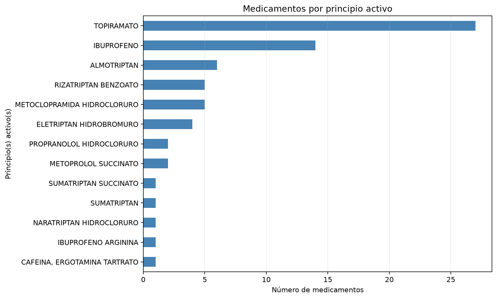
Topiramato e Ibuprofeno son los principios más comunes entre los datos.

## Frecuencia de las dosis

La dosis está expresada en miligramos (mg), que indica la cantidad de principio activo que contiene el fármaco.

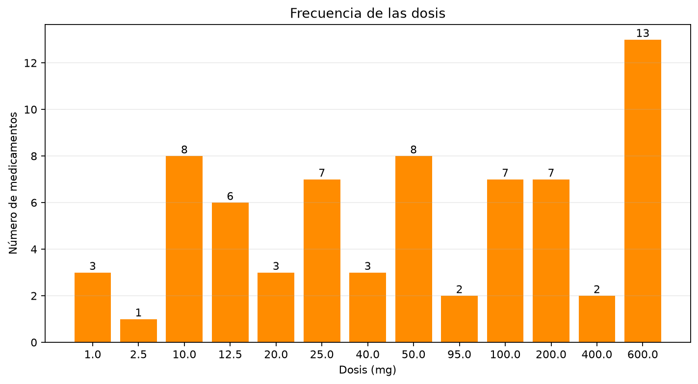

A priori no se observa un patrón en las dosis de los medicamentos.

## Forma farmacéutica simplificada y Vía de Administración

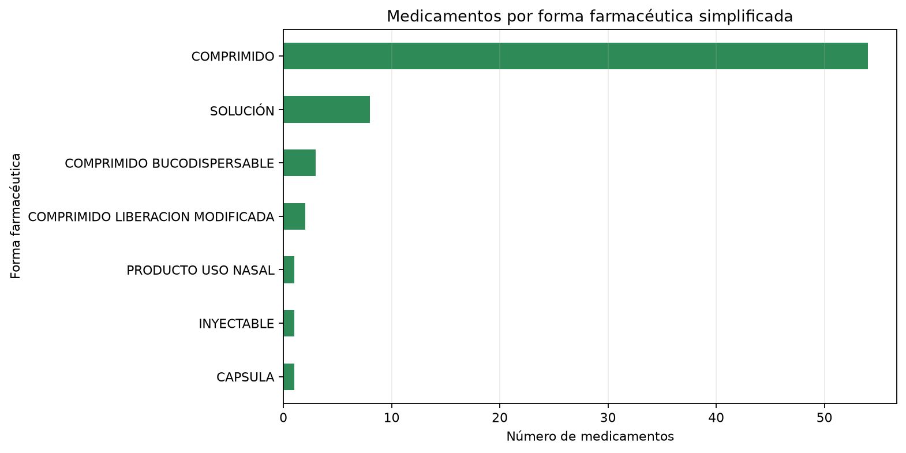

Las principales características son `COMPRIMIDO` y `SOLUCION`. Los comprimidos son prácticos de almacenar y administrar, sin asegurar que esa sea la causa de su predominio. Esto concuerda con que la vía oral sea la más representada. 

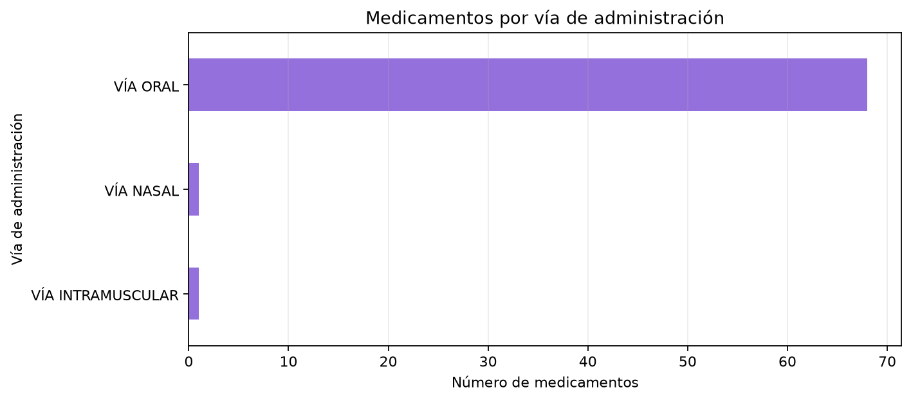

La escasez en las vías nasales e intramusculares podría deberse a que estas requieren material sanitario. No obstante, estas pueden ser útiles en circunstancias particulares.

## Año de autorización y revisión

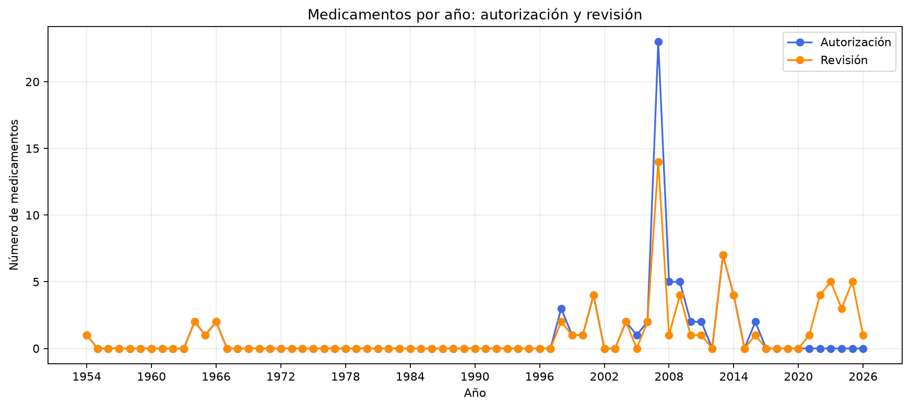

En este conjunto de datos no hay fechas de autorización posteriores a 2016. Además, solo 19 registros tienen una fecha de revisión original (todas entre 2021 y 2026), y el resto son valores nulos sustituidos por so fecha de autorización. 

No se informa del resultado de cada revisión: si el medicamento se mantuvo, se retiró o cambió de estado.

## Comercialización

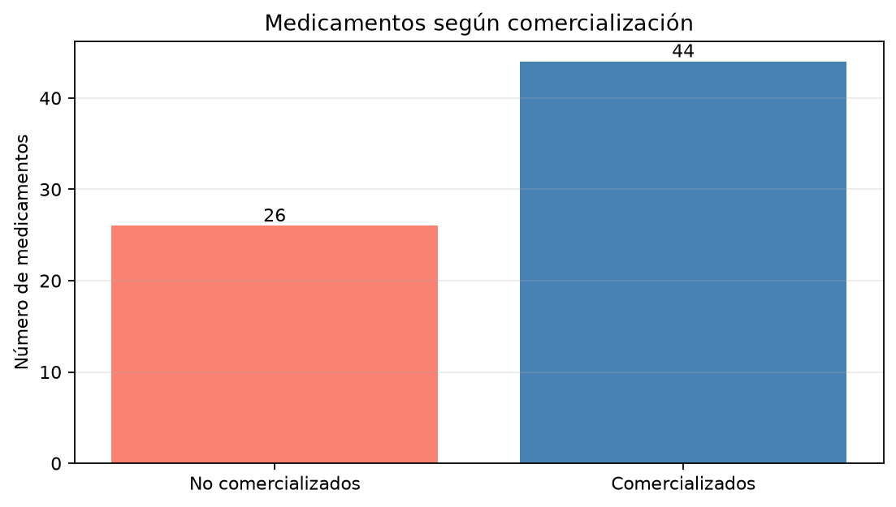

La no comercialización de 26 medicamentos podría deberse a diferentes causas: retirada, falta de lanzamiento, o de disponibilidad.

## Genéricos

Un medicamento genérico es aquel que tiene el mismo componente activo, seguridad y eficacia que el original de marca. Se puede fabricar y vender a menor precio una vez que caduca la patente del medicamento original.

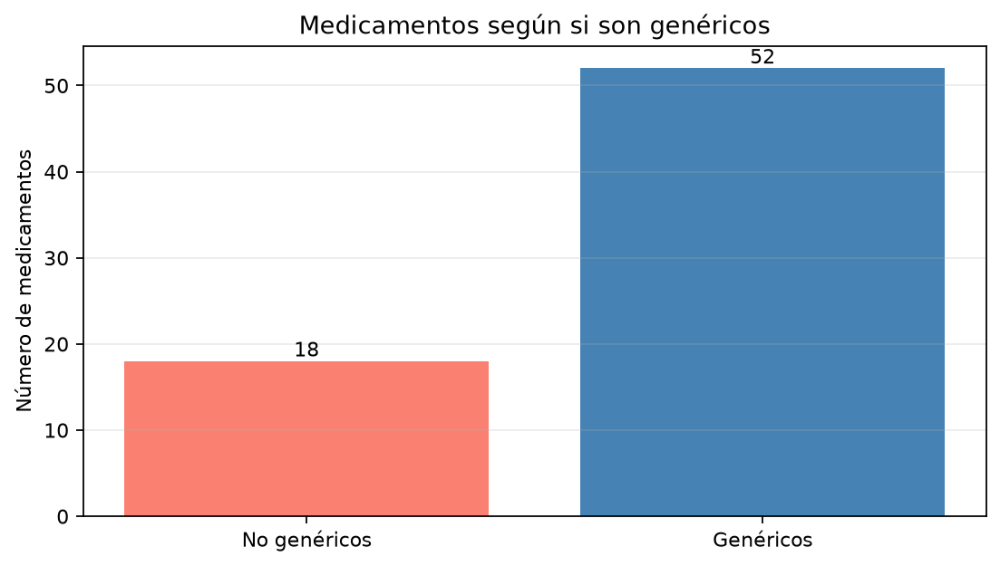

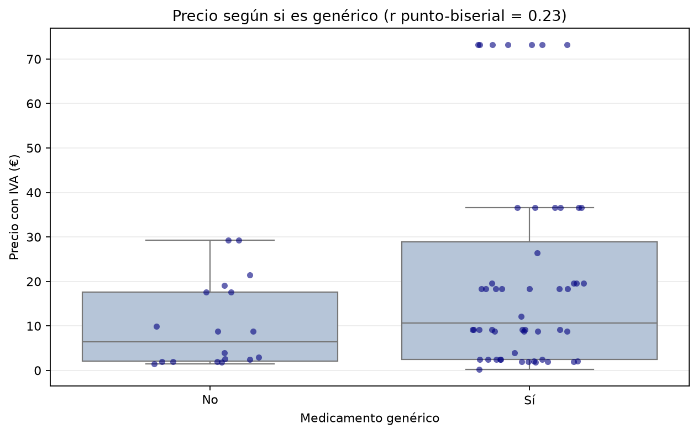

En este caso, no se observa ninguna relación entre los medicamentos genéricos y un precio menor. Los medicamentos no genéricos podrían seguir una distribución en el precio similar (o incluso menor) a los genéricos.

## Efecto en la conducción

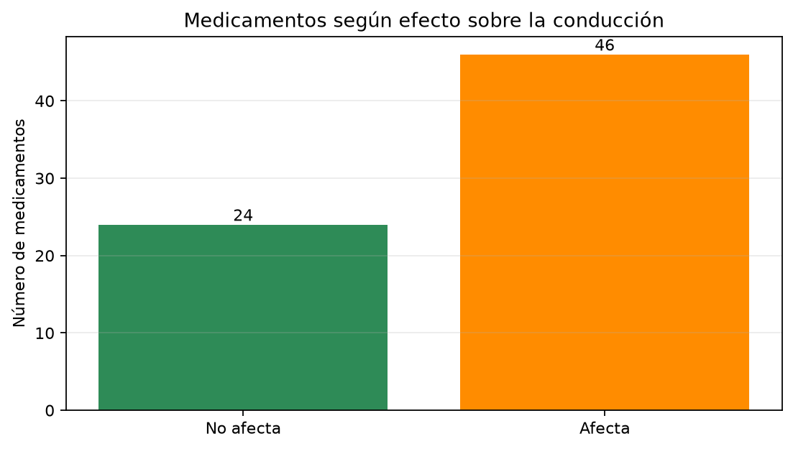

Estas advertencias suelen relacionarse con posibles efectos que alteren la atención, la visión o el estado de alerta. No se deduce que, para todas las personas que los tomen, se vaya a ver afectada su capacidad de conducción.

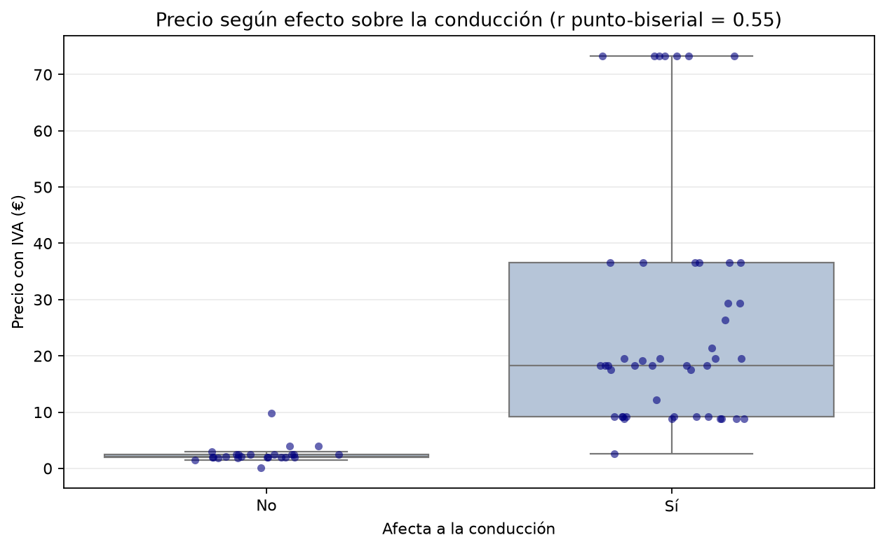

En este caso sí se observa una correlación con el precio, siendo más baratos aquellos medicamentos que no afectan a la conducción.

## Número de principios activos

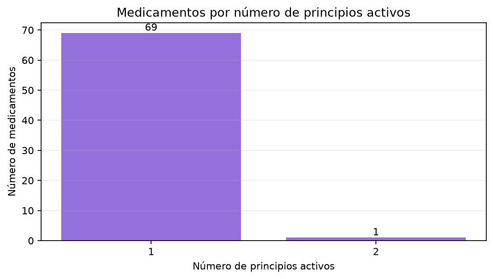

Solamente hay un medicamento que combina dos principios activos. Este medicamento es `CAFERGOT 1 mg/100 mg COMPRIMIDOS`. Cada comprimido tiene 1mg de `ERGOTAMINA TARTRATO` y 100 mg de `CAFEINA`. Se usa para ataques de migraña agudos. [Fuente](https://www.e-lactancia.org/media/papers/ErgotaminaCafergot-FT-AEMPS-Amdipharm2009.pdf)

## Volumen informativo e indicador de riesgo

El volumen informativo corresponde al número de palabras de la sección 4.4 de la ficha técnica. 

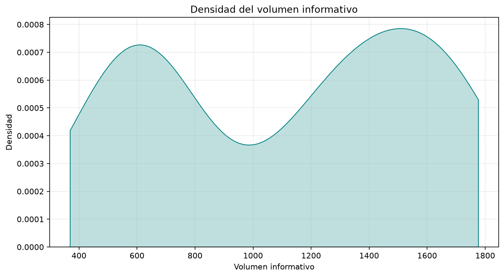

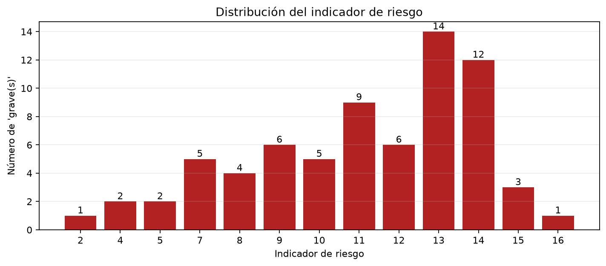

El indicador de riesgo se refiere al número de apariciones de las palabras «grave» o «graves» en la ficha técnica; no es medida clínica de riesgo.

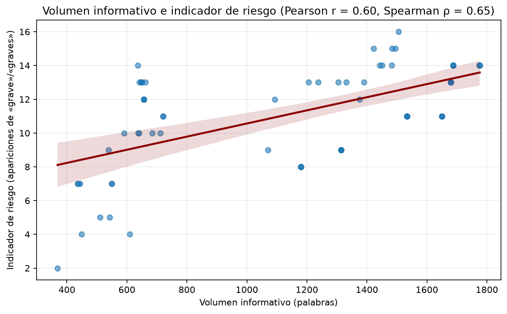

Cuantas más palabras y más extensa sea la sección 4.4, más veces aparece potencialmente la palabra «grave».

## Complejidad de desglose

La complejidad del desglose se refiere al número de tablas de la ficha técnica correspondiente. En la muestra, 26 registros no tienen ninguna tabla.

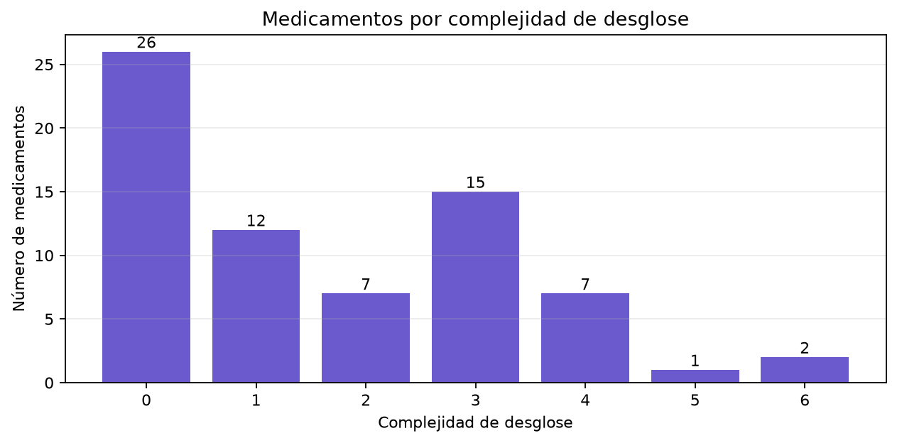

## Estado

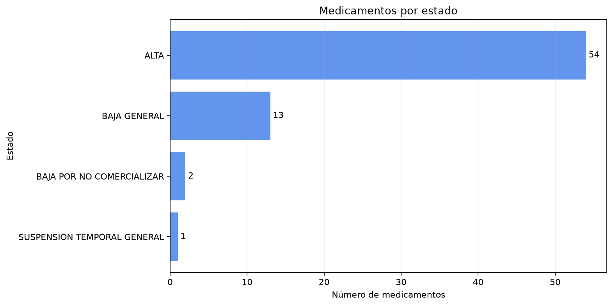

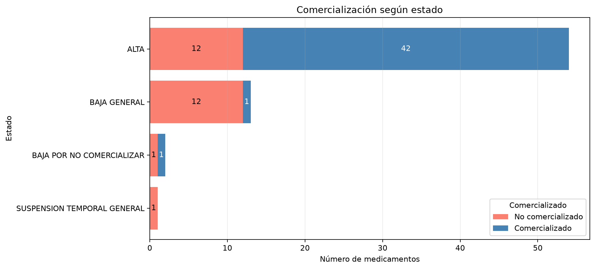

54 de los 70 registros figuran de alta, frente a 13 de baja general, 2 de baja por no comercializarse y 1 con suspensión temporal general. Por tanto, en este conjunto predominan los medicamentos que constan como activos administrativamente. El gráfico no explica las causas de las bajas o de la suspensión; para ello habría que consultar la información administrativa de cada medicamento.

## Distribución del precio de venta al público

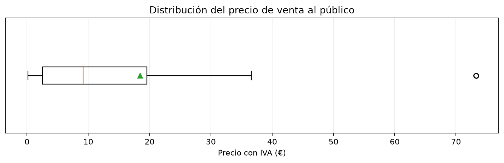

Esta gráfica usa los 70 precios añadidos manualmente a partir de otras fuentes en `HU4_EDA.xlsx`. No hay precios ausentes en ese archivo; la mediana es 9,16 €, el rango intercuartílico va de 2,50 € a 19,53 € y el rango total es de 0,17 € a 73,25 €.

## Frecuencia de los precios

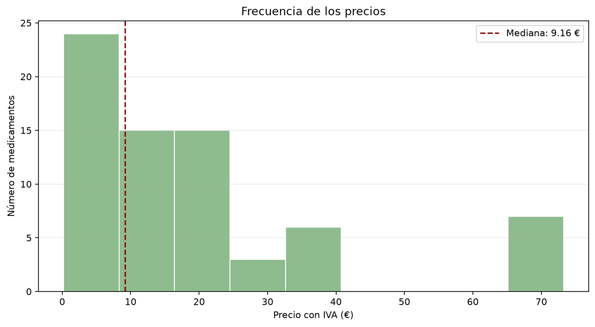

El histograma representa los 70 precios incluidos en `HU4_EDA.xlsx`; no contiene valores imputados aleatoriamente. La línea discontinua marca la mediana (9,16 €). Los precios van de 0,17 € a 73,25 €.

## Tratamiento de larga duración

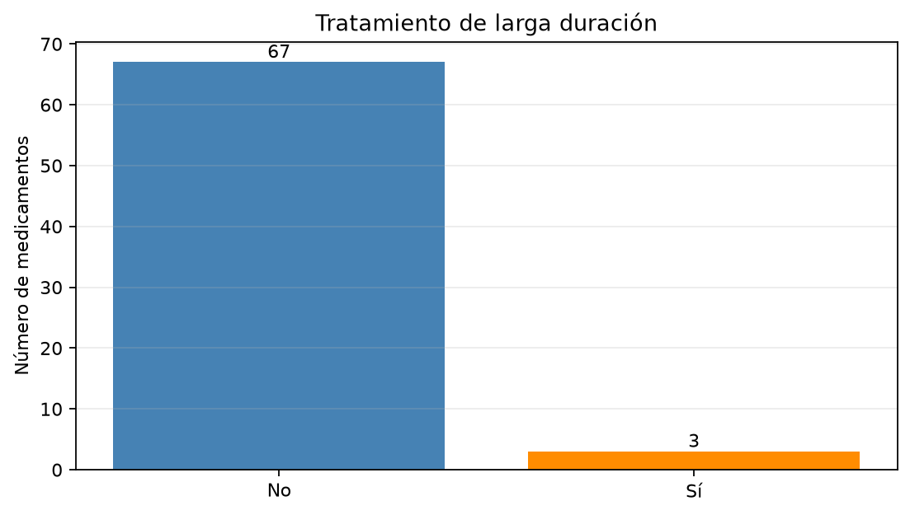

En los datos originales, 3 registros indican tratamiento de larga duración, 45 indican que no y 22 no tienen información. El procesamiento convirtió esos 22 valores ausentes en «NO», por lo que la gráfica muestra 3 «SÍ» y 67 «NO». El predominio de «NO» en la gráfica se debe en parte a esa imputación; no se puede concluir que los 67 casos sean realmente tratamientos no prolongados ni explicar por qué se indicó esa duración para cada medicamento.

## Gráficas exploratorias para machine learning

### Matriz de correlación

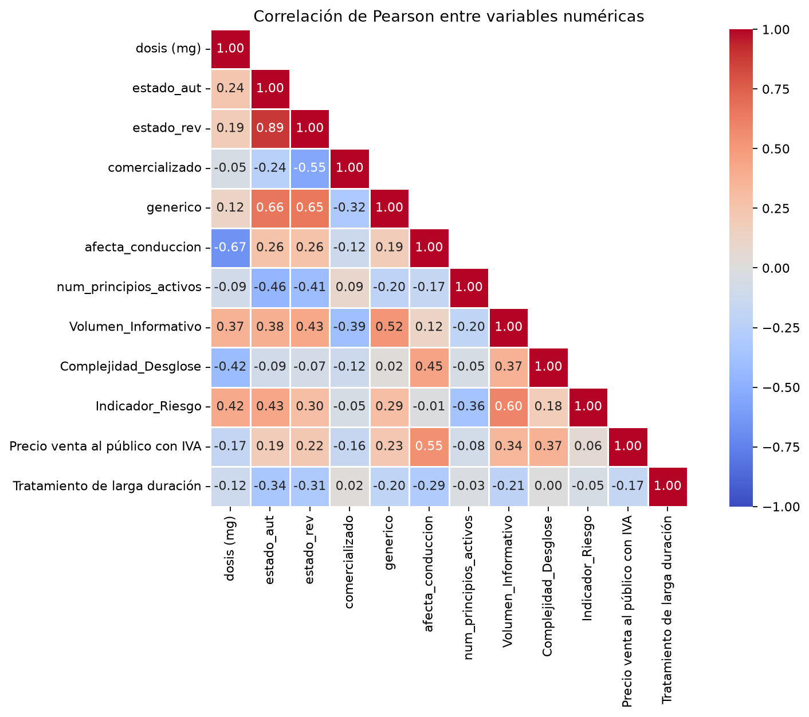

La matriz muestra correlaciones de Pearson entre las columnas numéricas, incluido el precio, los años de autorización y revisión y variables binarias como `comercializado`. Los precios se toman de `HU4_EDA.xlsx`: los 70 valores se añadieron manualmente a partir de otras fuentes y no hay valores ausentes. En esta muestra, el precio tiene su mayor correlación positiva con `afecta_conduccion` (r ≈ 0,55); esto solo indica asociación. La matriz sirve para explorar relaciones lineales y posibles predictores redundantes, no demuestra causalidad. Con solo 70 registros, los coeficientes deben interpretarse con cautela.

### Afectación de la conducción y dosis

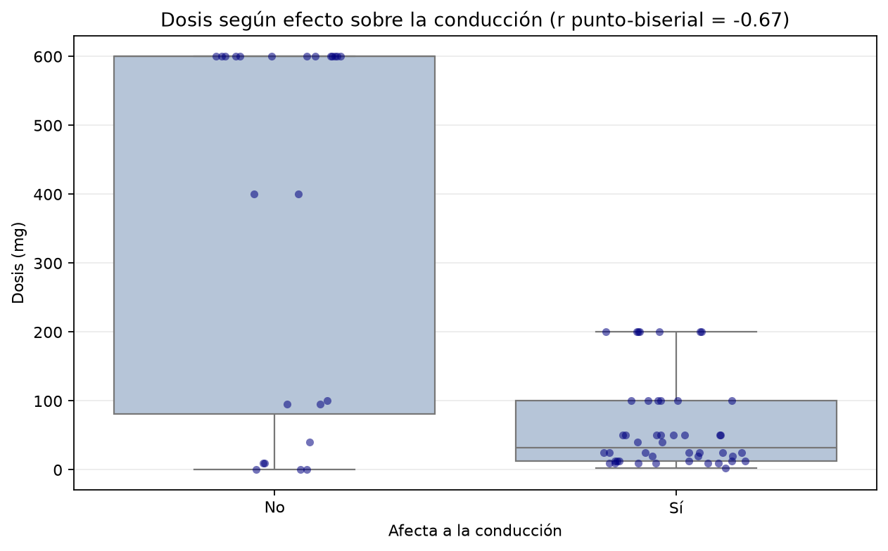

Como `afecta_conduccion` es binaria, se comparan las distribuciones de dosis de los grupos «No» y «Sí» con un diagrama de caja y los registros individuales. La correlación punto-biserial (equivalente a Pearson para una variable binaria) es aproximadamente −0,67 en esta muestra. Es una asociación, no evidencia de que la dosis cause el efecto sobre la conducción.

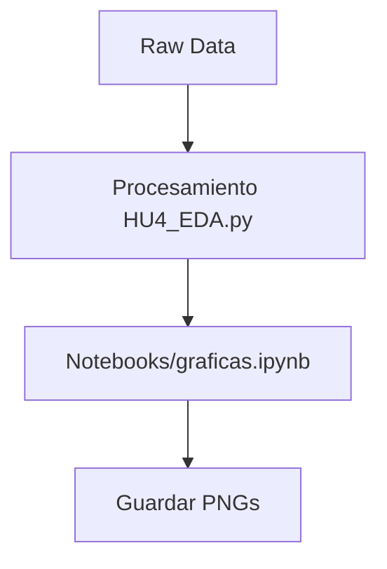
