# Gráficas explicativas de las variables

## Medicamentos por principio activo

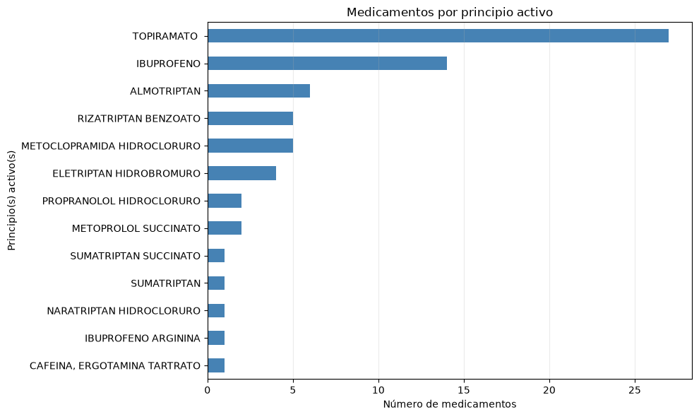
Esta gráfica cuenta los registros de medicamentos asociados a cada principio activo. Los más frecuentes son el topiramato (27 registros), el ibuprofeno (14) y el almotriptán (6). Estos recuentos describen los medicamentos incluidos en el conjunto de datos; no miden su consumo ni su popularidad entre los pacientes.

## Densidad de las dosis

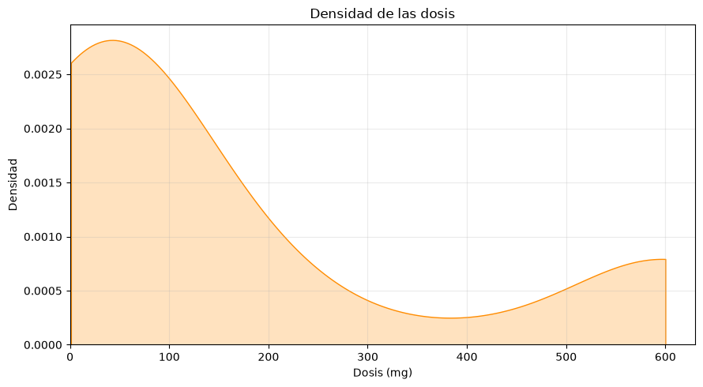

La curva de densidad estimada alcanza su máximo alrededor de 40–50 mg, desciende hasta un mínimo cercano a 380 mg y vuelve a subir hacia 600 mg. No conviene describirla como bimodal: 600 mg es el límite superior observado y la curva termina allí, por lo que ese ascenso no demuestra que exista un segundo máximo. En los datos, 600 mg es la dosis más frecuente (13 registros). La gráfica describe las dosis registradas para los medicamentos, no pautas de administración a pacientes.

## Medicamentos por forma farmacéutica simplificada

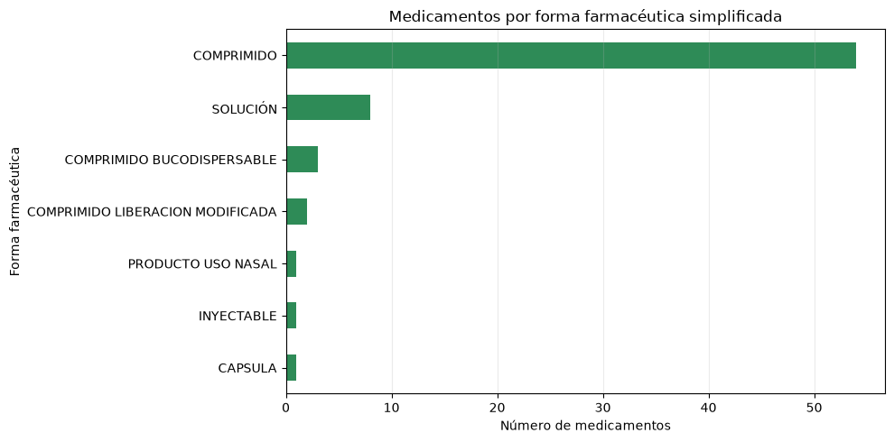

Este gráfico muestra el número de registros por forma farmacéutica: 54 de los 70 corresponden a comprimidos, más que todos los demás formatos juntos (16). Esto concuerda con que la vía oral sea la más representada. Los comprimidos suelen ser prácticos de almacenar y administrar, pero estos datos no permiten asegurar que esa sea la causa de su predominio ni explican las decisiones de formulación.

## Medicamentos por año de autorización

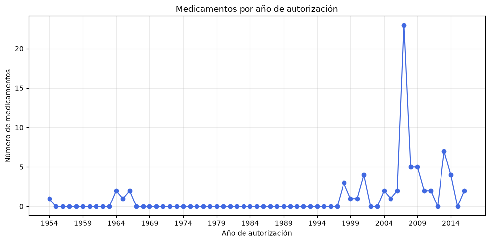

Entre 1954 y 1997 se registran seis fechas de autorización. A partir de 1998, los recuentos por año varían y alcanzan un máximo de 23 en 2007. En este conjunto de datos no hay fechas de autorización posteriores a 2016.

## Medicamentos por año de revisión

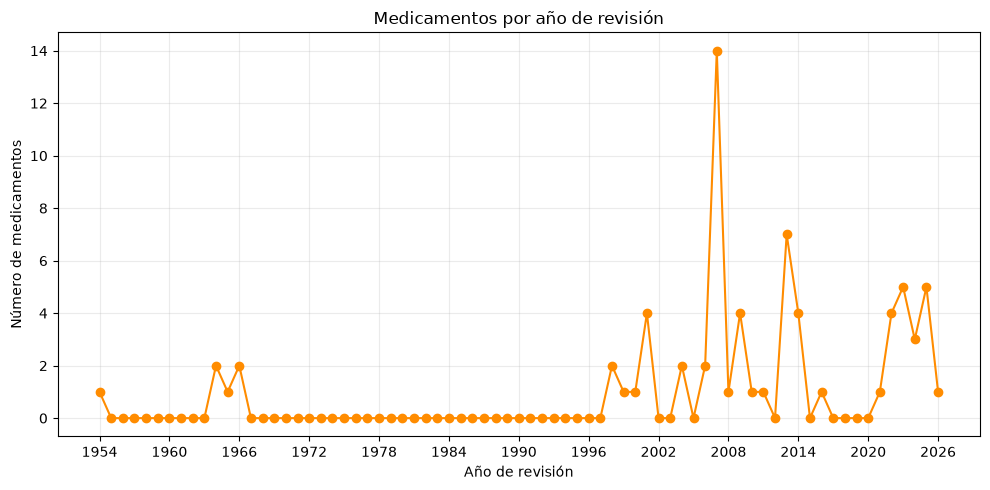

Esta gráfica no representa de forma fiable las fechas de revisión originales: en el archivo de entrada faltan para 51 de los 70 registros y el procesamiento sustituyó cada fecha ausente por la fecha de autorización. Solo 19 registros tienen una fecha de revisión original; todas están entre 2021 y 2026. Por tanto, los recuentos de esta gráfica mezclan fechas de revisión reales con fechas de autorización imputadas.

## Medicamentos por año: autorización y revisión

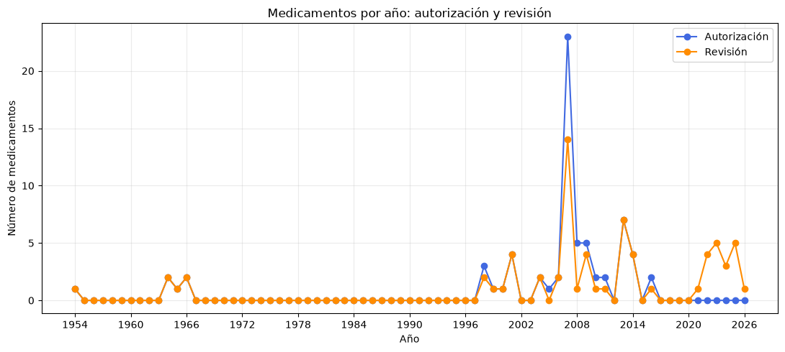

La gráfica compara las fechas de autorización con las fechas de revisión disponibles, pero estas últimas tienen la limitación indicada arriba: 51 fechas ausentes se reemplazaron por fechas de autorización. En los 19 registros con fecha de revisión original, estas se sitúan entre 2021 y 2026, mientras que sus fechas de autorización son anteriores. La comparación no informa del resultado de cada revisión (por ejemplo, si el medicamento se mantuvo, se retiró o cambió de estado).

## Medicamentos por vía de administración

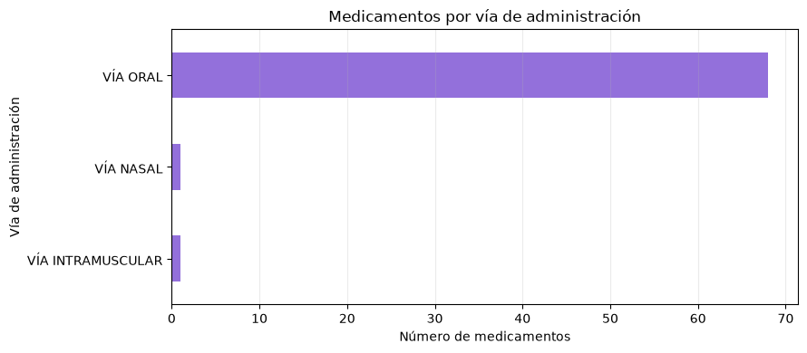

68 de los 70 registros (aproximadamente el 97 %) corresponden a medicamentos de administración oral; uno es de administración nasal y otro intramuscular. Una posible razón práctica de este predominio es que los medicamentos orales suelen ser fáciles de administrar y no requieren material sanitario. Sin embargo, la gráfica cuenta medicamentos del catálogo, no unidades consumidas ni preferencias de pacientes, y no permite confirmar por qué se eligió cada vía. Las vías no orales pueden ser útiles en circunstancias particulares, por ejemplo, cuando la administración oral no resulta adecuada.

## Medicamentos según comercialización

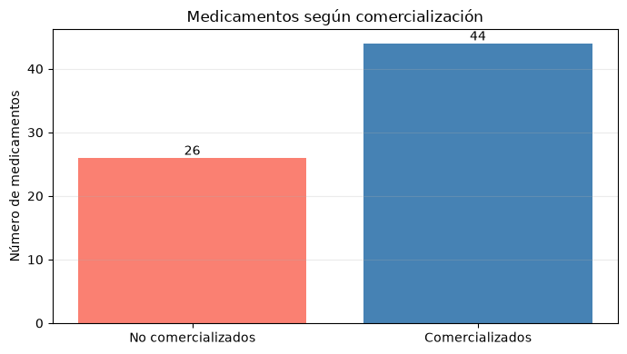

44 de los 70 registros figuran como comercializados y 26 como no comercializados. Esto describe el estado que recoge el conjunto de datos, no el motivo de que algunos no se comercialicen. La variable no indica si se debe a una retirada, falta de lanzamiento, disponibilidad u otra causa, así que no se puede atribuir una razón concreta con esta gráfica.

## Medicamentos según si son genéricos

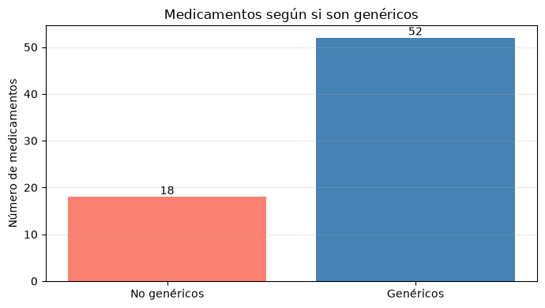

52 de los 70 registros están marcados como genéricos y 18 no. Esto muestra que los genéricos están ampliamente representados en la selección. La disponibilidad de genéricos suele ser posible cuando un medicamento puede comercializarse sin la exclusividad del producto original; aun así, el conjunto no incluye información de patentes ni fechas de vencimiento, por lo que no permite confirmar por qué cada producto es genérico.

## Medicamentos según efecto sobre la conducción

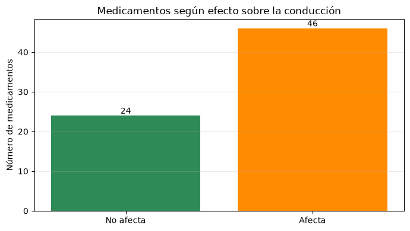

46 de los 70 registros están marcados como medicamentos que pueden afectar a la conducción y 24 no. Estas advertencias suelen relacionarse con posibles efectos que alteren la atención, la visión o el estado de alerta. La gráfica, sin embargo, no identifica qué efecto ni qué evidencia motivó la advertencia de cada medicamento; tampoco significa que todas las personas que los tomen vayan a ver afectada su capacidad para conducir.

## Medicamentos por número de principios activos

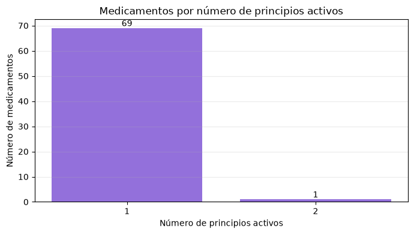

69 de los 70 registros tienen un único principio activo y solo uno combina dos. Esto indica que, en esta selección, predominan los medicamentos de un solo principio activo. La gráfica cuenta productos y no explica por qué se diseñó cada formulación; para conocer la finalidad de la combinación habría que revisar la ficha técnica del medicamento concreto.

## Densidad del volumen informativo

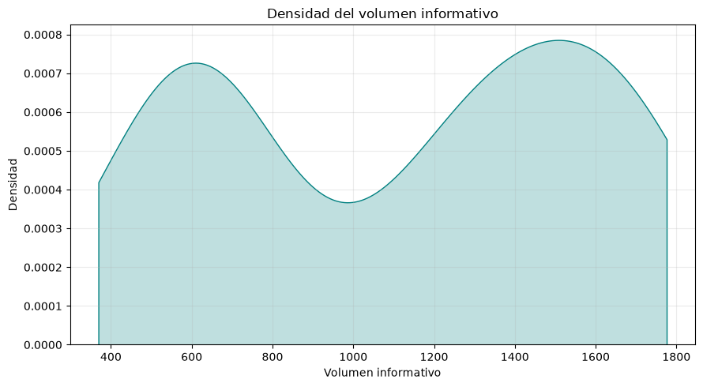

El volumen informativo corresponde al número de palabras de la sección 4.4 de la ficha técnica. En esta muestra, la curva de densidad estimada presenta dos zonas de mayor concentración, alrededor de 600 y 1.500 palabras; son estimaciones suavizadas, no categorías ni valores exactos.

## Medicamentos por complejidad de desglose

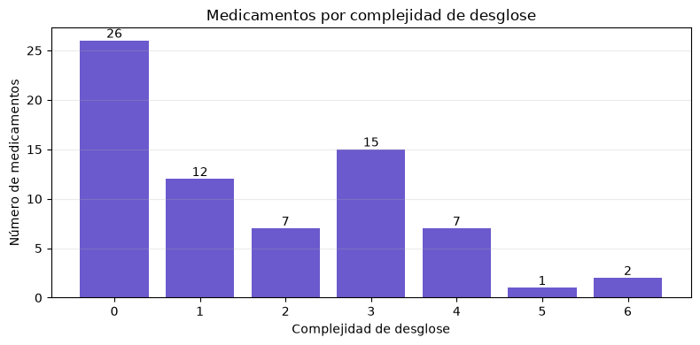

La complejidad del desglose es el número de tablas de la ficha técnica. En la muestra, 26 registros tienen valor 0, 15 tienen valor 3 y 12 tienen valor 1; los demás se reparten entre los valores 2, 4, 5 y 6.

## Distribución del indicador de riesgo

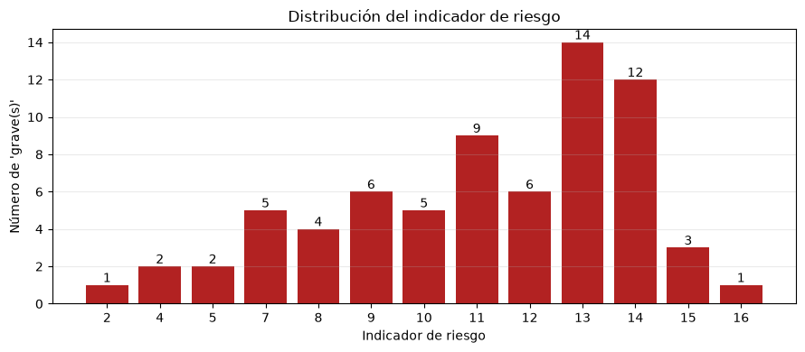

El indicador cuenta las apariciones de las palabras «grave» o «graves» en la ficha técnica; no es por sí solo una medida clínica de riesgo. Los valores más frecuentes son 13 (14 registros) y 14 (12).

## Medicamentos por estado

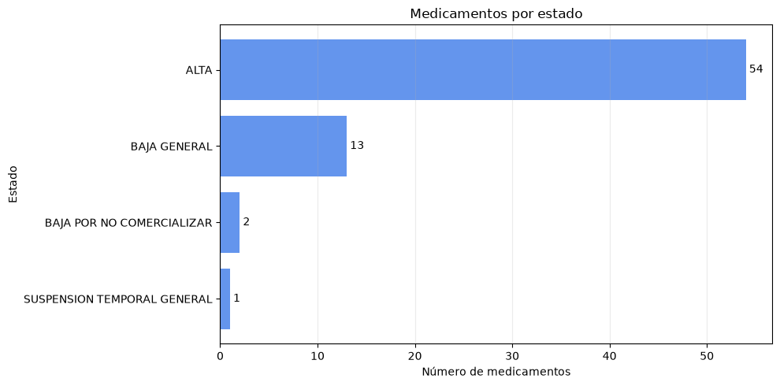

54 de los 70 registros figuran de alta, frente a 13 de baja general, 2 de baja por no comercializarse y 1 con suspensión temporal general. Por tanto, en este conjunto predominan los medicamentos que constan como activos administrativamente. El gráfico no explica las causas de las bajas o de la suspensión; para ello habría que consultar la información administrativa de cada medicamento.

## Distribución del precio de venta al público

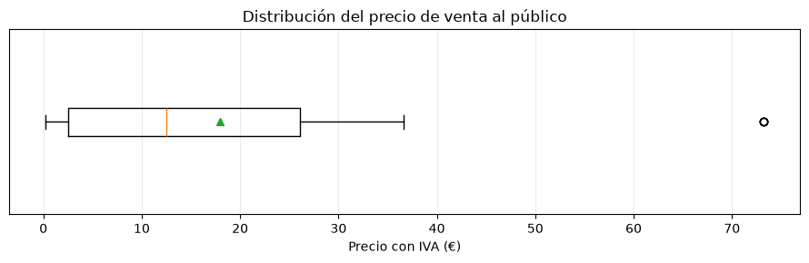

Este diagrama de caja representa los precios con IVA del archivo procesado, pero 22 de los 70 precios estaban ausentes en los datos originales y se sustituyeron por valores aleatorios entre el precio mínimo y 40 €. Por ello, la mediana y los cuartiles de la gráfica no describen exclusivamente precios observados. En los 48 precios originales disponibles, la mediana es 8,80 € y el máximo es 73,25 €.

## Frecuencia de los precios

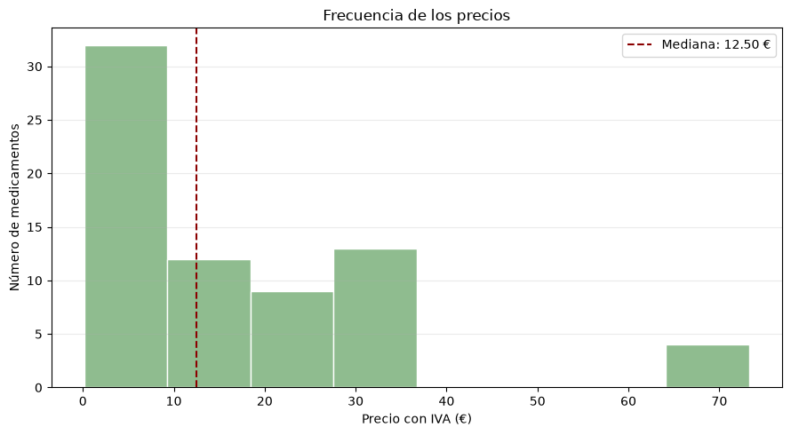

El histograma también incluye los 22 precios imputados aleatoriamente, así que sus frecuencias por intervalo no representan solo valores observados. La línea discontinua marca la mediana del archivo procesado (12,50 €); para los 48 precios originales disponibles, la mediana es 8,80 €. En los datos originales, los precios observados van de 0,17 € a 73,25 €.

## Tratamiento de larga duración

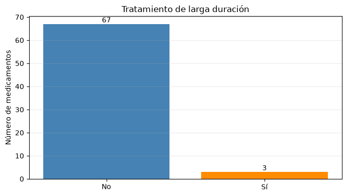

En los datos originales, 3 registros indican tratamiento de larga duración, 45 indican que no y 22 no tienen información. El procesamiento convirtió esos 22 valores ausentes en «NO», por lo que la gráfica muestra 3 «SÍ» y 67 «NO». El predominio de «NO» en la gráfica se debe en parte a esa imputación; no se puede concluir que los 67 casos sean realmente tratamientos no prolongados ni explicar por qué se indicó esa duración para cada medicamento.